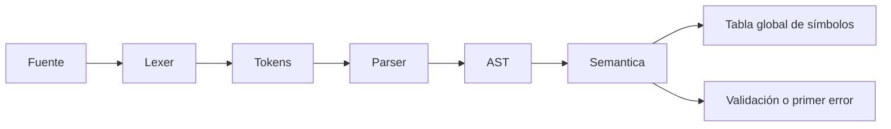

# Entrega 3: análisis semántico

## Diagnóstico inicial y procedencia

El proyecto principal tenía lexer, parser descendente recursivo, nueve clases AST,
siete pruebas de integración y cuatro notebooks. No tenía carpeta `semantic/`.
La rama inicial era `main`, sin cambios pendientes, con remoto
[Dereklemus12/Compilador-USPG-Lexer-Parser-AST](https://github.com/Dereklemus12/Compilador-USPG-Lexer-Parser-AST).
El commit inicial era `d5cbfdd`. La carpeta `docs/` estaba vacía.
No se trabajó en la copia histórica ni se sustituyó el lexer personalizado.

La plantilla se localizó en el
[repositorio de semántica del docente](https://github.com/ciarenasg-uspg/compilador-entrega-semantica),
commit `5fc51c0a3de764118b43cf6fac5645f730dde6b5`.
[Archivo original](https://github.com/ciarenasg-uspg/compilador-entrega-semantica/blob/5fc51c0a3de764118b43cf6fac5645f730dde6b5/semantic/analizador.py),
blob Git `aff5707f2ee6c6e6657d8db0a11dc8cf1c1797ea`.
El repositorio de parser corresponde a la entrega anterior y no contiene semántica.

**Diferencia verificable:** el README del docente enumera seis métodos TODO,
pero ese archivo tiene cinco pendientes: 1, 2, 3, 5 y 6. El cuarto,
`visitar_OpBinaria`, ya contiene las reglas base. Se completaron los cinco
pendientes y se amplió el cuarto para `%`; no se inventaron nombres o firmas.

## Arquitectura e interfaces

`Lexer(codigo).analizar()` devuelve tokens con EOF. `Parser(tokens).parsear()`
devuelve un `Programa`. `AnalizadorSemantico().analizar(ast)` recorre el árbol
mediante Visitor: busca `visitar_` seguido del nombre de la clase del nodo.
Las expresiones devuelven tipos; las sentencias normalmente devuelven `None`.

Se conserva `compilar(codigo) -> (tokens, ast)` para los consumidores anteriores.
La función nueva `validar(codigo) -> (tokens, ast, semantico)` ejecuta las tres
fases. El programa de consola realiza el mismo flujo mostrando cada fase.

## Compatibilidad del AST

Las clases anteriores mantienen sus nombres y sus argumentos posicionales.
Se añadió la base `NodoAST` y propiedades de lectura con los nombres esperados
por la plantilla:

| Nodo | Atributo propio | Alias del docente |
|---|---|---|
| Declaracion | nombre, valor | id, expr; tipo siempre `entero` |
| Asignacion | nombre, valor | id, expr |
| OpBinaria | izquierda, operador, derecha | izq, op, der |
| Imprimir | expresion | expr |
| Si | cuerpo | bloque_v |
| Mientras | cuerpo | bloque |

Declaraciones, asignaciones e identificadores reciben la línea del token.
El nuevo campo tiene valor predeterminado 1 para construcciones manuales y se
excluye de representación y comparación para conservar el comportamiento previo.
Los constructores locales no se sustituyeron por los del docente. Las propiedades
permiten adaptar el visitante a este AST sin reescribir el parser ni sus pruebas.

## Los seis métodos y sus responsabilidades

| Método conservado | Responsabilidad final |
|---|---|
| `visitar_Declaracion(self, nodo: Declaracion) -> None` | Rechaza duplicados, analiza inicializador si existe, exige el tipo declarado y registra al final. |
| `visitar_Asignacion(self, nodo: Asignacion) -> None` | Verifica existencia, infiere el tipo de la expresión y lo compara con el registrado. |
| `visitar_Identificador(self, nodo: Identificador) -> str` | Busca el nombre, devuelve su tipo o lanza `NameError` con línea. |
| `visitar_OpBinaria(self, nodo: OpBinaria) -> str` | Analiza ambos operandos, exige enteros y devuelve `entero` o `booleano`. Ampliación de código ya resuelto en la plantilla. |
| `visitar_Si(self, nodo: Si) -> None` | Exige condición booleana y visita cada sentencia de `bloque_v`. |
| `visitar_Mientras(self, nodo: Mientras) -> None` | Exige condición booleana y visita cada sentencia de `bloque` una sola vez, sin ejecutar el ciclo. |

En `entero x = x + 1;`, registrar después del inicializador impide que `x`
se utilice para declararse a sí misma. Un inicializador inválido no deja un
símbolo registrado. El análisis se detiene en el primer error; la tabla parcial
solo describe lo validado hasta ese punto. Para un programa distinto se crea
una instancia nueva del analizador.

## Sistema de tipos

| Construcción | Restricción | Tipo resultante |
|---|---|---|
| Literal numérico | Entero reconocido por el lexer | entero |
| Identificador | Declarado previamente | Tipo guardado |
| `+ - * / %` | Dos enteros | entero |
| `== != < > <= >=` | Dos enteros | booleano |
| Declaración y asignación | Expresión del mismo tipo que la variable | Sin tipo de expresión |
| `si`, `mientras` | Condición booleana | Sin tipo de expresión |
| `imprimir` | Cualquier expresión válida | Sin tipo de expresión |

Solo se declaran variables `entero`, pero una comparación produce `booleano`.
Por eso `entero x = 1 < 2;`, `(1 < 2) + 3` y `(1 < 2) % 3` son casos
representables con error de tipos. No se añadieron literales booleanos, cadenas,
decimales, funciones ni nuevos tokens. El signo negativo sigue representándose
como `0 - expresión` y utiliza la regla aritmética existente.

La división devuelve tipo entero según la especificación: el compilador no
decide ni calcula su valor. Tampoco calcula divisores para detectar división
o módulo por cero. `10 % 0` supera esta comprobación de tipos; eso no constituye
una garantía de ejecución segura. No hay ejecución en esta entrega.

## Tabla de símbolos

Se conserva exactamente el diccionario de la plantilla: `{nombre: tipo}`.

| Información | Representación |
|---|---|
| Nombre | Clave del diccionario |
| Tipo declarado | Valor, actualmente `entero` |
| Declarado | Presencia de la clave |
| Alcance | Global, único para todo el programa |
| Inicialización | No se registra ni se exige; fuera del contrato base |
| Ubicación | Línea en los nodos de declaración, asignación e identificador; no en la tabla |
| Valor de ejecución | No se almacena ni se calcula |

La sintaxis propia ya admitía `entero x;`; se conserva y registra el tipo.
El uso posterior de esa variable se admite porque la plantilla no comprueba
asignación definida. No se incorporó un análisis de flujo no solicitado.

Los bloques comparten la tabla global. Incluso dentro de una condición falsa
se visita el bloque y se registran declaraciones: no se evalúa la condición.
Esta simplificación intencional permite detectar errores dentro de ambos tipos
de bloque, pero no representa el comportamiento dinámico de un lenguaje completo.

La [evidencia de evolución](../evidencias/semantico/evolucion_tabla_simbolos.txt)
se genera visitando las sentencias reales del ejemplo de módulo. Muestra tabla
vacía, incorporación de `numero`, `divisor`, `residuo` y conservación al visitar `Si`.

## Extensiones personales

`%` sigue la ruta `OP_MODULO -> producto() -> OpBinaria -> visitar_OpBinaria`.
La precedencia y asociatividad del parser se conservan. Solo se amplía el conjunto
aritmético del visitante: dos enteros producen entero y un booleano se rechaza.
No hace falta crear un nodo ni un visitante nuevos.

La declaración sin inicializador y el negativo unario anteriores se conservan.
Los paréntesis y signos de estructura ya están resueltos en el parser; no producen
tipos propios. `<=` y `>=` utilizan la misma regla de comparaciones de la plantilla.

## Errores, pruebas y diferencias con la referencia

`NameError`: duplicado, uso o asignación sin declarar; incluye nombre y línea.
`TypeError`: incompatibilidad de inicializador, asignación, operandos o condición.
`NotImplementedError`: nodo AST sin visitante. El CLI devuelve 1 ante errores
de fuente y 0 cuando la fase solicitada termina correctamente.

Las pruebas propias cubren casos válidos y negativos, operadores en ambos lados,
condiciones, bloques, tabla global, autorreferencia, tipos y contrato de consola.
Se ejecutan con assertions sobre tipos, tabla, excepciones y códigos de salida.
La suite actual contiene **41 pruebas: 7 anteriores y 34 nuevas**, sin omisiones.
Además se verifican 16 archivos por consola: 5 válidos y 11 errores esperados
(dos sintácticos y nueve semánticos). Ver [resumen generado](../evidencias/semantico/resumen.txt).

Una prueba de la referencia docente espera `TypeError` para `1 < x < 5`.
La gramática existente solo admite una comparación por expresión y la rechaza
antes, con `SyntaxError`. Se conserva esa gramática y se documenta la diferencia;
no se afirma que la suite remota completa haya pasado sin adaptar interfaces.
El caso equivalente `(1 < x) < 5`, representable con paréntesis, se rechaza por
tipos mediante la regla de operandos enteros. Las pruebas anteriores no se modifican.

No son expresables las asignaciones de cadenas o decimales, ni referencias a
ámbitos locales o funciones. No se fabrican programas de esos tipos para probarlos.
No hay TAC, intérprete, VM, recuperación tras errores ni análisis de inicialización.

## Archivos de la entrega

Modificados: `main.py` (flujo y consola), `arbol_ast/nodos.py` (compatibilidad y
líneas), `parser/parser.py` (propagación de líneas), `README.md` (nueva entrega)
y `.gitignore` (temporales, entornos y archivos de credenciales).

Creados: `semantic/__init__.py`, `semantic/analizador.py`,
`pruebas/test_semantico.py`, casos 08 a 16 de `pruebas/`,
`pruebas/generar_evidencias_semantico.py`, las guías 06 a 08 de `docs/`,
`notebooks/05_Analisis_Semantico.ipynb`, `notebooks/preparar_semantico.py`,
`notebooks/requirements.txt` y salidas de `evidencias/semantico/`.

Se conservan sin editar el lexer, sus tokens, las siete pruebas anteriores,
los casos 01 a 07, los cuatro notebooks previos y sus evidencias históricas.
